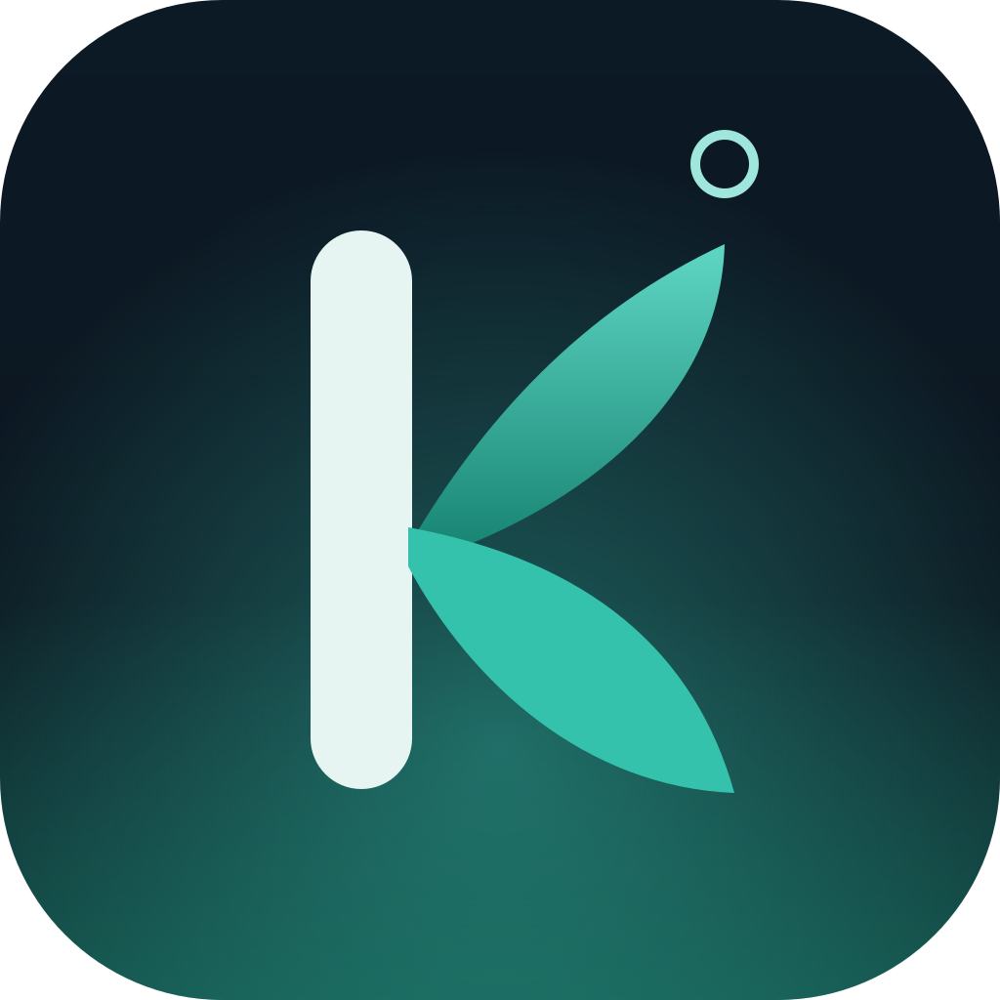
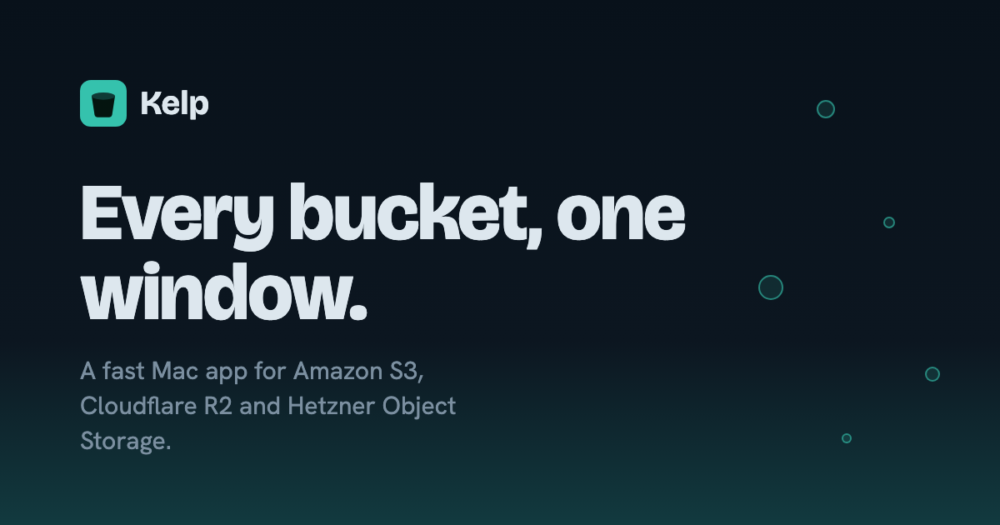

<p align="center">
  
</p>

<h1 align="center">Kelp</h1>

<p align="center">
  A fast, native-feeling Mac app for Amazon S3, Cloudflare R2 and Hetzner Object Storage.
  <br>
  <a href="https://kelp.ozanai.dev"><strong>Download</strong></a> ·
  <a href="https://kelp.ozanai.dev/docs/">Docs</a> ·
  <a href="https://kelp.ozanai.dev/whats-new/">What's new</a>
</p>

<p align="center">
  
</p>

## Features

- **Three providers, one window.** Amazon S3, Cloudflare R2 and Hetzner Object Storage side by side, with tabs.
- **Transfers that survive bad Wi-Fi.** Large files move in parallel parts; pause, resume, quit and pick up where
  you left off. Failed parts retry on their own.
- **Drag and drop.** Drop files or folders from Finder to upload. Drag rows to move them, or onto another
  connection to copy between providers.
- **Quick previews.** Press Space to look at images, text and video, streamed straight from your bucket.
- **Keyboard first.** ⌘K jumps to any bucket, folder or command.
- **Bucket and folder sizes**, counted in the background on request.
- **Feels like a Mac app.** Frosted sidebar, light and dark themes, and updates that install themselves.

## Privacy and security

- Secret keys live only in the macOS Keychain, unlocked with Touch ID. Never in a file, a log or an error message.
- Files go straight between your Mac and your storage provider. There is no Kelp server.
- No analytics, no telemetry, no tracking.

The details are on the [privacy page](https://kelp.ozanai.dev/privacy/).

## Install

Download the latest version from [kelp.ozanai.dev](https://kelp.ozanai.dev). It's signed and notarised by Apple
and updates itself.

Requires a Mac with Apple Silicon and macOS 13 or later.

## Build from source

You need:

- A Mac with Apple Silicon
- [Rust](https://rustup.rs) 1.90 or newer
- Node.js 22 or newer
- Xcode Command Line Tools: `xcode-select --install`

```bash
cd app
npm install
npm run tauri dev      # opens Kelp with hot reload
npm run tauri build    # builds Kelp.app and a .dmg
```

Dev builds keep secrets in per-connection Keychain items. To stop the Keychain asking for your password on every
rebuild, sign dev builds with your "Apple Development" certificate by setting `KELP_DEV_SIGNING_IDENTITY`.
Release builds are covered under [Signed releases](#signed-releases).

## How it's built

A Rust core does all the work; a React UI shows it. They talk through [Tauri 2](https://tauri.app).

```
React UI  ──invoke / events──▶  Tauri commands  ──▶  providers  ──▶  S3 API
   ▲                                  │
   └────────── events ◀── transfers (queue + workers, tokio)
```

| Folder | What's in it |
|---|---|
| `app/src/` | The UI: React, TypeScript, Vite. Every call to Rust goes through `lib/tauri.ts`. |
| `app/src-tauri/src/` | The Rust core: commands, the S3 provider, the transfer engine, Keychain access, previews. |
| `website/` | The landing site at [kelp.ozanai.dev](https://kelp.ozanai.dev), prerendered with Vite and React. |
| `design/` | Shared design tokens, components, fonts and the logo generator. |
| `docs/` | Design specs, implementation plans and the release guide. |

S3, R2 and Hetzner share one implementation (`providers/s3.rs`); their differences are connection settings, not
separate code. [`SPEC.md`](SPEC.md) is the full design.

## Development

```bash
# Rust core
cargo test   --manifest-path app/src-tauri/Cargo.toml
cargo clippy --manifest-path app/src-tauri/Cargo.toml -- -D warnings
cargo fmt    --manifest-path app/src-tauri/Cargo.toml

# App UI
cd app && npm test && npm run typecheck

# Website
cd website && npm run dev     # local preview
cd website && npm run build   # type-check, prerender and check every page
cd website && npm test        # theme, path and contrast checks

# Design reference sheet
python3 -m http.server 8000 -d design   # then open http://localhost:8000/reference/
```

CI runs the same checks on every pull request.

## Contributing

Bug reports, ideas and pull requests are welcome.

1. Open an issue first for anything larger than a small fix, so we can agree on the approach.
2. Keep pull requests small and focused, with clear commit messages.
3. Run the checks above before you push.
4. Follow the conventions in [`CLAUDE.md`](CLAUDE.md). The main ones:
   - The UI never talks to storage directly; only `providers/` knows about S3.
   - Secrets never appear in files, logs, error messages or tests.
   - No code comments: clear names, small functions and tests instead.
   - Plain CSS using the tokens in `design/tokens.css`.
   - UI text is sentence case and says exactly what a button does.

By contributing, you agree that your contributions are licensed under the GPL 3.0 or later.

## Security

Please don't report security problems in public issues. Use GitHub's private vulnerability reporting on this
repository (Security → Report a vulnerability), and include steps to reproduce. Never include real keys.

## Keyboard shortcuts

| Keys | Does |
|---|---|
| ⌘K | Command palette (places and actions) |
| Space | Preview the selected file |
| ⌘R | Refresh the folder |
| ⌘D | Download the selection |
| ⌘⇧N | New folder |
| ⌘T / ⌘W | New tab / close tab |
| ⌘⇧] / ⌘⇧[ | Next / previous tab |
| ⌘, | Settings |
| ⌫ or ⌘↑ | Up one folder |
| ⌥ while dropping rows | Copy instead of move |

## For maintainers

### Signed releases

Release builds keep secrets in one Keychain item unlocked with Touch ID, which needs a Developer ID provisioning
profile. Once:

1. developer.apple.com → Certificates, IDs & Profiles → Identifiers → + → App IDs → App. Bundle ID
   `dev.ozanai.kelp` (explicit), description "Kelp", no extra capabilities.
2. Profiles → + → Developer ID → that App ID → your Developer ID Application certificate → Generate → Download.
3. Save it as `app/src-tauri/Kelp.provisionprofile` (gitignored).

Then build with your identity in the environment, never in the repository:

```bash
export KELP_TEAM_ID=<your Team ID>
export APPLE_SIGNING_IDENTITY="Developer ID Application: <name> (<Team ID>)"
cd app && npm run tauri build
```

After a release build has moved your secrets into the new item, `tauri dev` on the same Mac asks for the secret
keys again.

### Releasing

Pushing a `v*` tag builds a signed, notarised release onto Cloudflare R2 without publishing it; the **Publish
release** workflow makes it live for downloads, the auto-updater and the website. Step by step, with rollback:
[`docs/RELEASING.md`](docs/RELEASING.md).

## License

Kelp is free software, licensed under the [GNU General Public License v3.0 or later](LICENSE). You can use, study,
change and share it; if you distribute a changed version, it must be under the same licence with its source.

The fonts in `design/fonts/` are under the SIL Open Font License; see the `OFL-*.txt` files next to them.
